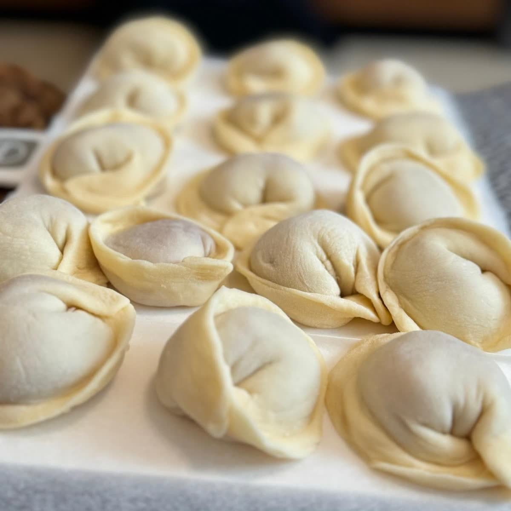
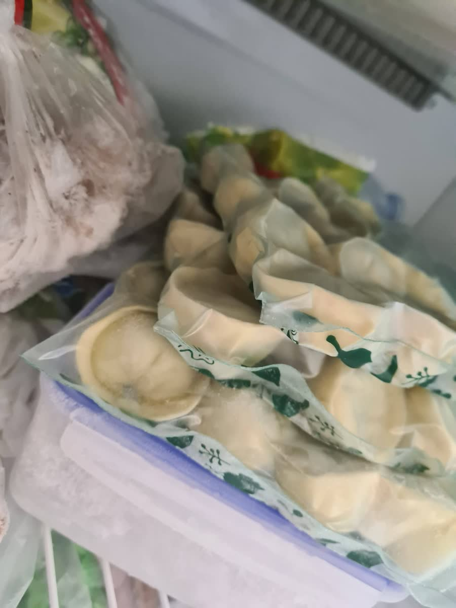
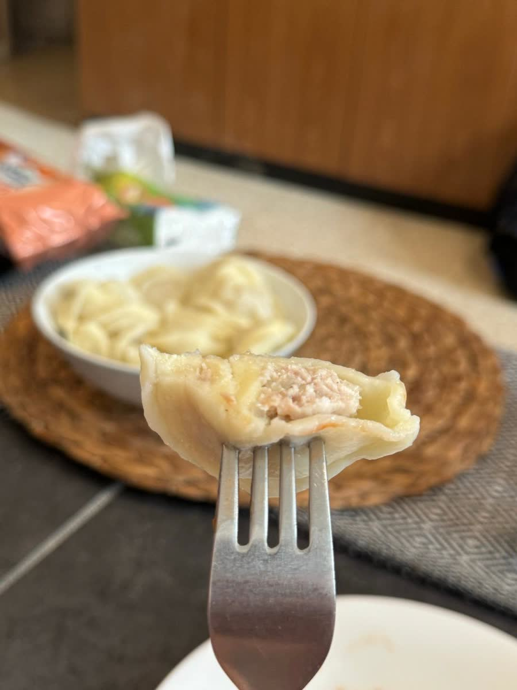

[Back to Menu](../index.MD)

# Pelmeni Dough Recipe

## Ingredients

- 300g “00” pasta flour or bread flour
- 6g salt (2% of the flour weight)
- 1 egg
- 1 egg yolk
- Cold water (enough to bring the wet ingredients to 185g total)

## Filling option

Use the [chicken mince mixture](./chicken_mince_mix.MD) as an optional filling. Adjust the filling quantity to the amount of dough.

## Instructions

1. Process the flour and salt in a food processor for 10 seconds.
2. Weigh the egg, egg yolk, and enough cold water to reach 185g total.
3. Process until the dough forms.
4. Knead the dough by hand for 12 minutes.
5. Alternatively, use the well method to mix the ingredients by hand.
6. Flour the dough, wrap it in plastic, and let it rest at room temperature for 30 minutes.

|                           ★                            |                          ★                           |
| :----------------------------------------------------: | :--------------------------------------------------: |
|               |  |
|  |             |
