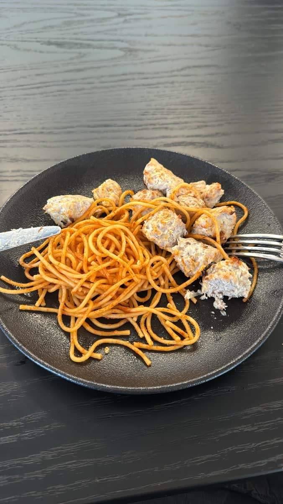
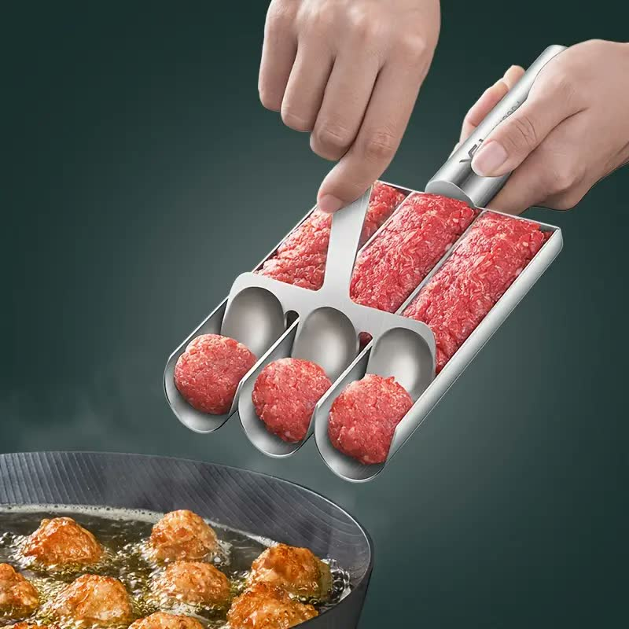

[חזרה לתפריט](../index.MD)

# קציצות עוף מהירות של סש

## מרכיבים:

- כמות מלאה של [תערובת עוף טחון](./chicken_mince_mix.MD)

הכמות מספיקה לשתי תבניות תנור. הקציצות המוכנות מתאימות להקפאה ולחימום חוזר במיקרוגל או בתנור.

## אופן הכנה:

1. להכין את [תערובת העוף הטחון](./chicken_mince_mix.MD), כולל בישול הבצל מראש וקירורו עם קרח לפני הערבוב עם הבשר.
2. לחמם תנור ל-230 מעלות במצב טורבו.
3. להכין כדורים מהעיסה (מומלץ להשתמש במכשיר לכדרור קציצות).
4. לרווח בין הקציצות כדי לתת להן מקום להוציא נוזלים.
5. להכניס לתנור שחומם מראש ולבשל במשך 10-15 דקות עד שהקצוות מתחילות להשחים.

ניתן לקנות את מכשיר הקציצות [כאן](https://a.aliexpress.com/_oD9yzu5)

|                          ★                          |                         ★                         |
| :-------------------------------------------------: | :-----------------------------------------------: |
|  |  |
